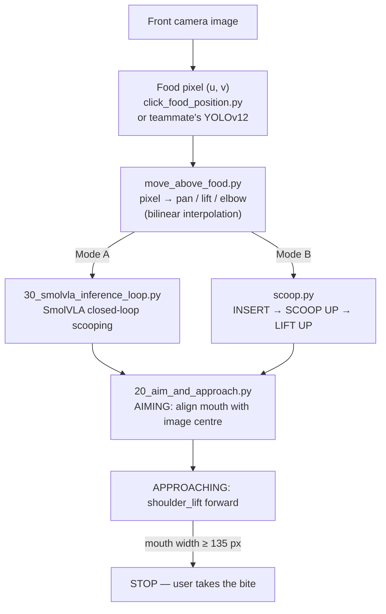

# SO-101 Assistive Feeding: Food Scooping and Mouth-Tracking Visual Servoing

Code for the food acquisition and bite transfer stages of a low-cost assistive feeding robot built on the
LeRobot SO-101 arm, developed as part of an NUS Undergraduate Research Opportunities Programme (UROP) project.

The feeding cycle consists of:

1. **Food localisation** (`move_above_food`) — converts the pixel position of the selected food in the front
   camera into joint angles by bilinear interpolation between four calibrated corner poses.
2. **Scooping**, using one of two modes:
   - **Mode A – SmolVLA policy**: a learned Vision-Language-Action policy trained on teleoperated demonstrations.
   - **Mode B – Fixed-delta sequence**: a deterministic INSERT → SCOOP UP → LIFT UP motion.
3. **Bite transfer** — eye-in-hand visual servoing that aligns the spoon with the user's mouth using
   MediaPipe facial landmarks, then advances until the mouth width reaches a stopping threshold.

## Repository structure

```
├── scooping/
│   ├── move_above_food.py         # pixel → joint angles (bilinear interpolation over 4 corner poses)
│   ├── click_food_position.py     # click on the food in the camera view, then move above it
│   └── scoop.py                   # fixed-delta scooping: INSERT → SCOOP UP → LIFT UP (Mode B)
├── visual_servoing/
│   └── 20_aim_and_approach.py     # mouth tracking: aiming + approaching
├── smolvla/
│   ├── train_commands.md          # training commands for v5 / v6 / v7
│   ├── 30_smolvla_inference_loop.py  # closed-loop SmolVLA inference on the arm (Mode A)
│   └── configs/                   # saved policy configs
└── analysis/
    ├── parameter_comparison.py    # v5 / v6 vs smolvla_base parameter comparison
    └── data_distribution.py       # distribution of scooping positions in the dataset
```

## How it works

### Pipeline overview



All scripts talk to the arm through LeRobot's `SO101Follower`: each control step reads the current joint
positions with `robot.get_observation()` and sends a full target pose with `robot.send_action(pose)`.

### 1. Food localisation — `scooping/move_above_food.py`

- **Calibration:** four corner poses (`CORNERS`) store the `shoulder_pan`, `shoulder_lift` and `elbow_flex`
  values that place the spoon above the four corners of the front-camera view (640 × 480).
- **Mapping:** the pixel is first flipped on both axes to match the camera orientation
  (`u' = 640 − u`, `v' = 480 − v`). With `tx = u'/640` and `ty = v'/480`, each joint is interpolated along the top
  and bottom edges, and then between the two edges:

  ```
  top    = TL + tx · (TR − TL)
  bottom = BL + tx · (BR − BL)
  joint  = top + ty · (bottom − top)
  ```

- **Target pose:** `CENTER_POSE` provides fixed wrist and gripper values; only pan, lift and elbow are replaced.
- **Motion:** `move_to_pose()` moves every joint towards the target by at most `MAX_DELTA = 3.0` per step at
  `MOVE_FPS = 10`, so the arm moves smoothly instead of jumping.
- `click_food_position.py` is an interactive front end: it shows the front camera, the user clicks on the food,
  presses Enter, and `move_above_food()` is called with the clicked pixel.

### 2a. Scooping Mode B (fixed-delta) — `scooping/scoop.py`

`execute_scoop()` runs three phases. Each phase adds a fixed joint-delta vector to the **current** pose, so the
same motion works wherever `move_above_food` has placed the spoon:

| Phase | Δ pan | Δ lift | Δ elbow | Δ wrist_flex | Purpose |
|---|---|---|---|---|---|
| INSERT | −2.95 | +8.60 | −7.13 | +7.99 | lower and tilt the spoon into the food |
| SCOOP UP | +1.18 | +12.79 | +3.52 | −24.28 | rotate the wrist to collect food |
| LIFT UP | +0.52 | −14.55 | −6.65 | +0.93 | raise the spoon while keeping it level |

`wrist_roll` and `gripper` are unchanged. Each phase is executed with the same rate-limited motion
(3 per step, 10 Hz), followed by a pause of `STEP_PAUSE = 0.8` s. The deltas were derived from four joint poses
recorded during a successful manual scoop (listed in the script comments).

### 2b. Scooping Mode A (SmolVLA) — `smolvla/30_smolvla_inference_loop.py`

1. Connect the arm together with the front and side cameras (640 × 480, 30 fps).
2. Load the trained policy with `SmolVLAPolicy.from_pretrained(MODEL_PATH)` and build the pre/post-processors.
3. Move above the food with `move_above_food()` (fixed pixel `FOOD_PIXEL_X`, `FOOD_PIXEL_Y`).
4. Loop at `INFERENCE_FPS = 10`:
   - read both camera images and the 6-D joint state;
   - normalise the state with the dataset mean / std;
   - call `policy.select_action()` with the images, state and the instruction `"Scoop the mashed potatoes"`;
   - un-normalise the action and send it to the arm.

`select_action()` internally predicts a chunk of 50 actions and returns them one per call, so a new forward
pass is only run once the chunk is used up. Inference is synchronous. The policy has no termination signal and
runs until Ctrl+C or `q` is pressed.

> The camera keys (`front`, `side`) and the hard-coded normalisation statistics match **v5**. Policies fine-tuned
> from `smolvla_base` (v6, v7) were trained with `front → camera1`, `side → camera2` and an empty third camera,
> so the observation keys must be renamed accordingly before using this script with them.

### 3. Bite transfer — `visual_servoing/20_aim_and_approach.py`

The side camera is mounted on the arm (eye-in-hand), so centring the mouth in its image aligns the spoon
with the mouth. The script runs a two-state controller at `MOVE_FPS = 6`:

1. **Home:** move to `HOME_POSE`, where the side camera faces the user.
2. **Mouth detection:** MediaPipe Face Landmarker returns 478 landmarks. The mouth centre is the midpoint of
   landmarks 13 and 14 (inner upper / lower lip), and the mouth width is the horizontal distance between
   landmarks 61 and 291 (mouth corners). Errors are measured from the image centre (320, 240):
   `error_x = mouth_x − 320`, `error_y = mouth_y − 240`.
3. **Horizontal correction (always active):** `Δpan = clamp(0.01 · error_x, −1.5, 1.5)`.
4. **AIMING (vertical):** while `|error_y| ≥ 40`, the elbow moves towards the mouth with a piecewise step:
   `clamp(0.03 · |error_y|, 1.5, 3.0)` when `|error_y| ≥ 80`, and a fixed `0.8` when `40 ≤ |error_y| < 80`.
   Once `|error_y| < 40`, the elbow is locked and the state switches to APPROACHING.
5. **APPROACHING:** `shoulder_lift` advances by `0.8` per step while the elbow stays locked and pan keeps
   correcting `error_x`.
6. **Stop:** when the mouth width reaches `STOP_DISTANCE_PX = 135` px, the arm stops.
7. **Face lost:** all joints are held at their current positions and only the elbow is raised by `1.5` per step
   to search for the face; aiming resumes when the face is found again.

### 4. Analysis scripts — `analysis/`

- **`parameter_comparison.py`:** loads `model.safetensors` of v5 / v6 and `lerobot/smolvla_base`, matches layers
  by name, and reports the mean absolute and relative difference per module (vision model, text model, action
  expert, other). Frozen modules that show ~0% difference indicate initialisation from pretrained weights.
- **`data_distribution.py`:** for each demonstration in the dataset, takes the frame where `shoulder_pan` deviates
  furthest from its starting value as the scooping moment, and plots histograms of `shoulder_pan` (left–right)
  and `shoulder_lift` (near–far) at that frame.

### Notes

- The robot is created with `use_degrees=False`, so joint values are in LeRobot's normalised range rather than
  degrees.
- `move_above_food` and the SmolVLA policy both assume that the front camera and plate are in the same place as
  during calibration and data collection; mark their positions on the table.

## Hardware

- LeRobot SO-101 follower arm (spoon as end effector) and SO-101 leader arm for teleoperation
- Front camera (fixed, above the plate) and side camera (eye-in-hand, on the arm)
- NVIDIA Jetson Orin Nano Super

## Setup

```bash
conda activate lerobot
pip install -r requirements.txt
sudo chmod 666 /dev/ttyACM0      # robot serial port
```

The visual servoing script requires MediaPipe's `face_landmarker.task` model, which is not included here.
Download it from the official MediaPipe Face Landmarker page and place it next to the script.

Check the serial port (`/dev/ttyACM0` or `/dev/ttyACM1`) and camera indices at the top of each script before running.

## Usage

**Food localisation**

```bash
python scooping/click_food_position.py   # click on the food, press Enter, the arm moves above it
```

The four corner poses are stored in `CORNERS` at the top of `move_above_food.py`; re-record them if the
camera or plate is moved.

**Fixed-delta scooping (Mode B)**

```bash
python scooping/scoop.py                 # set FOOD_X, FOOD_Y in the script
```

**SmolVLA scooping (Mode A)**

```bash
python smolvla/30_smolvla_inference_loop.py   # set MODEL_PATH and FOOD_PIXEL_X / FOOD_PIXEL_Y
```

The policy keeps running until Ctrl+C (or `q` in the camera window) is pressed.

**Visual servoing (bite transfer)**

```bash
python visual_servoing/20_aim_and_approach.py   # Ctrl+C to stop
```

Key parameters (top of the script): `KP_PAN = 0.01`, `CENTER_TOLERANCE_PX = 40`, `FORWARD_STEP = 0.8`,
`STOP_DISTANCE_PX = 135`, `MOVE_FPS = 6`.

**SmolVLA training (Mode A)** — see [`smolvla/train_commands.md`](smolvla/train_commands.md).

**Analysis**

```bash
python analysis/parameter_comparison.py
python analysis/data_distribution.py
```

## Datasets and trained policies

| Resource | Link |
|---|---|
| Dataset (135 episodes) | https://huggingface.co/datasets/yannnnnn6/scooping-all-v3-merged |
| Cleaned dataset (114 episodes) | https://huggingface.co/datasets/yannnnnn6/scooping-all-v3-merged-clean |
| Policy v5 (no pretrained weights) | https://huggingface.co/yannnnnn6/scooping-smolvla-v5 |
| Policy v6 (fine-tuned from smolvla_base) | https://huggingface.co/yannnnnn6/scooping-smolvla-v6 |
| Policy v7 (fine-tuned, cleaned dataset) | https://huggingface.co/yannnnnn6/scooping-smolvla-v7 |

## Safety

The arm operates close to a person's face. Always run bite-transfer tests with a second person ready to stop
the arm, and keep approach speeds low.

## Acknowledgements

Supervised by Prof. Lim Li Hong Idris, National University of Singapore. Built on
[LeRobot](https://github.com/huggingface/lerobot), [SmolVLA](https://huggingface.co/lerobot/smolvla_base) and
[MediaPipe](https://ai.google.dev/edge/mediapipe).
